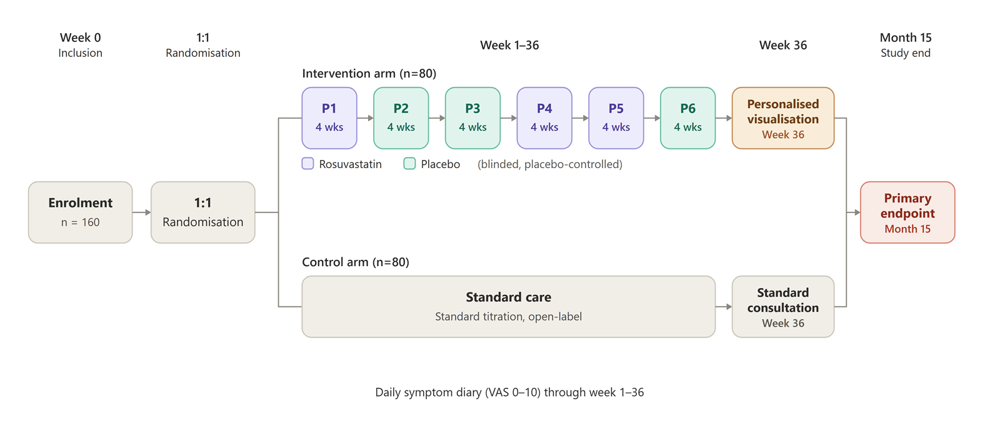

::: {.project-facts}
**Role:** Sponsor and principal investigator\
**Design:** Multicenter randomized controlled trial across 11 Danish cardiology lipid clinics\
**Status:** Approved in CTIS (2025-524955-30-01), protocol paper submitted October 2026\
**Funding:** Capital Region of Denmark, Bispebjerg Hospital research fund, Hørslev-Fonden\
**Sites:** Bispebjerg and Frederiksberg Hospital (sponsor site), Herlev and Gentofte Hospital, Zealand University Hospital Roskilde, Holbæk Hospital, Odense University Hospital, Hospital of Southern Jutland (Aabenraa), Esbjerg Hospital, Aarhus University Hospital, Regional Hospital Central Jutland (Viborg and Silkeborg), Gødstrup Regional Hospital and Aalborg University Hospital\
**Collaborators:** Christian Bork (Aalborg University Hospital, lipid clinic network), Morten Lamberts (Respons digital trial platform) and Darrel P. Francis (Imperial College London)
:::

Many patients stop statins because of muscle symptoms, but blinded trials show that most of those symptoms also appear on placebo. SAMSON-2 asks whether a patient's own blinded comparison changes that. Participants in the N-of-1 arm go through six blinded 28-day blocks, three on rosuvastatin 20 mg and three on identical placebo, separated by 14-day washouts. They record symptoms daily in an app and receive their personal result at the end. The control arm gets guideline-directed titration by the lipid clinic. The primary question is whether the N-of-1 result leads to more patients on a statin one year later.

The trial builds on the UK SAMSON trial by Howard, Francis and colleagues (2020). Darrel P. Francis (Imperial College London) collaborates on the design.

{.lightbox}
